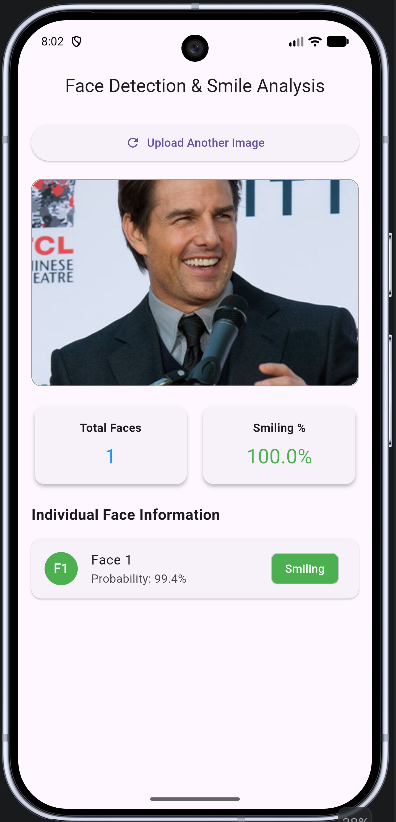
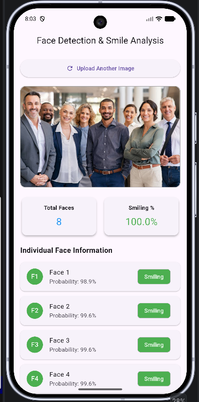
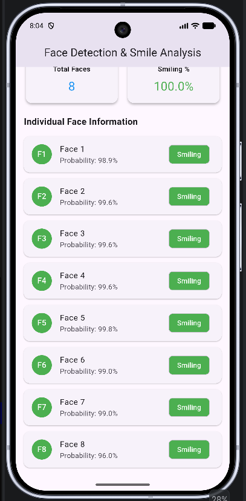

# Face Detection & Smile Analysis App

A professional Flutter cross-platform mobile application that leverages **Google ML Kit Face Detection** to analyze images from the device gallery, detect multiple human faces, calculate exact smiling percentages, and present detailed analytics using Clean Architecture and the Provider state management pattern.

---

## 🚀 Features

* **Image Picker Integration:** Seamlessly select photos from the device gallery for analysis.
* **Google ML Kit Face Detection:** High-performance local face detection with landmark and smile classification enabled.
* **Bounding Box Metrics:** Identifies and extracts precise facial coordinates and dimensions.
* **Automated Analytics Cards:**
    * Total detected face count.
    * Real-time smiling percentage calculation based on customized confidence thresholds ($\ge 70\%$).
* **Individual Face Breakdown:** Dedicated cards for each face showing individual smile status, face index number, and smile probability.
* **Clean Architecture:** Organized separation of concerns across Domain, Data, and Presentation layers.

---

## 🛠️ Tech Stack & Architecture

* **Framework:** Flutter (Dart)
* **State Management:** Provider
* **Machine Learning:** `google_mlkit_face_detection`
* **Media Selection:** `image_picker`
* **Architecture Pattern:** Clean Architecture (Domain-Data-Presentation split)

---
## For 1 man


## For 8 people




## 📁 Project Structure

```text
lib/
│
├── core/
│   └── utils/               # Helper utilities & constants
│
├── data/
│   ├── datasources/         # ML Kit & Image picker data service
│   └── repositories/        # Repository implementations
│
├── domain/
│   ├── entities/            # Core business models (FaceEntity)
│   └── repositories/        # Abstract repository interfaces
│
├── presentation/
│   ├── providers/           # State management (FaceProvider)
│   └── screens/             # UI Views (HomeScreen)
│
└── main.dart                # Entry point & dependency injection

